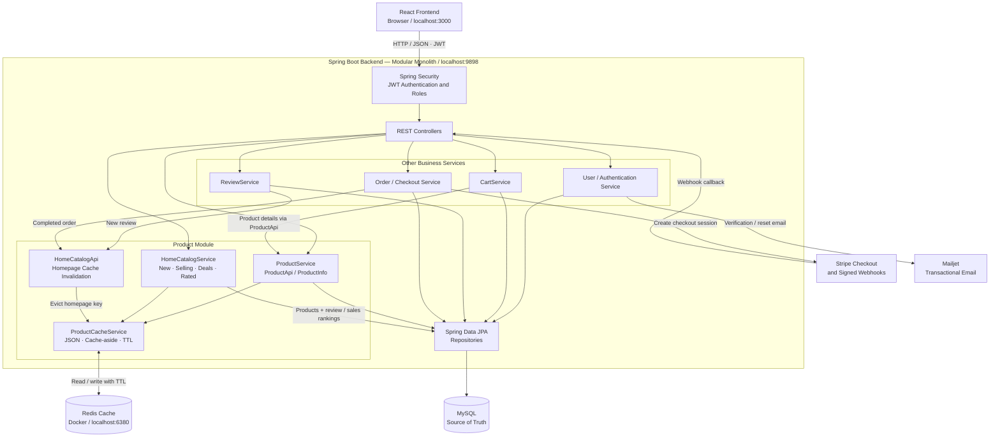

# Full-Stack E-Commerce Platform

A full-stack e-commerce application built with **React**, **Java 17**, **Spring Boot**, and **MySQL**. The project includes product discovery, user authentication, shopping-cart and order workflows, customer reviews, Stripe Checkout, and transactional email integration.

The backend has been incrementally improved with a more cohesive **Product module**, targeted **Redis cache-aside caching**, meaningful homepage rankings, environment-based configuration, and automated tests. This is a **modular Spring Boot application**, not a microservices system.

> **Project scope:** A local-development/portfolio application. Spring Boot, React, and MySQL run locally; Docker Compose is used for **Redis only**. No public deployment or CI/CD pipeline is claimed. Performance gains are not quantified here because a reproducible benchmark has not yet been run.

## Features

- **Product catalogue:** Individual product details, keyword search, pagination, sorting, and admin-restricted creation/updates.
- **Dynamic homepage:** Separate sections for **Newly Released** (recent additions), **Top Selling** (ordered quantity), **Exclusive Deals** (valid discounted prices), and **Top Rated** (review aggregates).
- **Accounts and access control:** User registration/login, JWT authentication, role-based authorization, and email verification/password-reset workflows.
- **Commerce workflows:** Cart and order management, Stripe-hosted checkout, webhook-driven order persistence, and PDF invoice generation.
- **Customer reviews:** Product reviews and review-derived rating summaries.
- **Redis caching:** Cache-aside reads for individual products and the composed homepage; TTL, mutation-driven invalidation, a configurable enable/disable switch, and database fallback when Redis is unavailable.
- **Testing:** JUnit 5/Mockito service tests and Spring MVC/controller authorization tests.

## Technology stack

| Layer | Technologies |
| --- | --- |
| Frontend | React 18, React Router, JavaScript, CSS |
| Backend | Java 17, Spring Boot 2.7.5, Spring Web |
| Security | Spring Security, JWT, role-based authorization |
| Persistence | Spring Data JPA, Hibernate, MySQL |
| Caching | Redis, Spring Data Redis (`RedisTemplate<String, String>`), Jackson JSON |
| Payments and email | Stripe Checkout/webhooks, Mailjet |
| Testing | JUnit 5, Mockito, Spring MVC Test, Spring Security Test |
| Build/development | Maven Wrapper, npm, Docker Compose (Redis only) |

## Architecture



The **Product module** groups its controller, service, repository, entity, DTOs, mapper, cache logic, and a narrow `ProductApi` contract for other business areas. `HomeCatalogService` composes Product, Review, and OrderItem data without adding review/order aggregation responsibilities to the Product CRUD service.

This diagram shows **logical components within one Spring Boot application**, not separately deployed microservices. Authentication happens in the security filter chain before protected controller operations. Redis is an optional cache; MySQL is the persistent system of record.

### Homepage ranking logic

| Section | Basis | Typical size |
| --- | --- | --- |
| Newly Released | Product `createdAt` descending | Up to 8 |
| Top Selling | Sum of ordered `OrderItem.quantity` per product | Up to 8 |
| Exclusive Deals | Non-null positive discounted price lower than regular price | Up to 8 |
| Top Rated | Average review rating, with review count as a tie-breaker | Up to 8 |

Review and sales rankings are aggregated by the database, then their product details are loaded in batches and assembled in the original ranking order. The homepage API returns four **named arrays** instead of one arbitrarily sliced product list.

### Cache behavior

| Key | Cached value | TTL |
| --- | --- | --- |
| `product:{id}` | Product response | 24 hours |
| `products:home` | Four-section homepage response | 10 minutes |

- **Cache hit:** Deserialize JSON from Redis and return the response without re-running the underlying database queries.
- **Cache miss:** Query MySQL, construct the response, then cache the serialized JSON with a TTL.
- **Product creation/update:** Invalidate the homepage key; updates also invalidate the affected product key.
- **Review creation / completed order:** Invalidate the homepage key so rating/sales sections are recalculated on the next request.
- **Redis failure:** Cache operations are best-effort. A timeout or connection error is logged and the underlying database request continues. Set `CACHE_ENABLED=false` to bypass caching intentionally.

Redis stores **rebuildable cache data only**, so the Compose service does not need a persistent volume. **MySQL is the source of truth** and is not started or managed by the Redis Compose file.

## Repository layout

```text
PROG8751-24F-Sec8-Capstone/
├── react-frontend/           # React client
├── spring-boot-backend/      # Spring Boot application
│   ├── src/main/java/com/app/ecommerce/
│   │   ├── modules/product/  # Product API, cache, service, DTOs, mapper
│   │   ├── controller/       # Other HTTP controllers
│   │   ├── service/          # User, cart, order, review, payment services
│   │   ├── repository/       # Other JPA repositories
│   │   └── security/         # JWT / Spring Security components
│   ├── src/main/resources/
│   ├── src/test/
│   ├── docker-compose.yml    # Redis only
│   ├── mvnw / mvnw.cmd
│   └── pom.xml
└── database-queries/         # SQL resources
```

## Running locally

### Prerequisites

- Java **17**, Node.js and npm, and a running **MySQL** server.
- **Docker Desktop** with the Linux Docker engine, if using Redis.
- Stripe and Mailjet test credentials for flows that call those services.

### 1. Clone the repository

```bash
git clone https://github.com/jagjeet7136/PROG8751-24F-Sec8-Capstone.git
cd PROG8751-24F-Sec8-Capstone
```

### 2. Prepare MySQL

Create a local schema, unless it already exists:

```sql
CREATE DATABASE IF NOT EXISTS ecommerce;
```

The backend's default JDBC URL is `jdbc:mysql://localhost:3306/ecommerce`. Configure credentials in your environment. Seed the roles/categories and any demo data needed by the specific screens; review the repository's `database-queries/` resources for existing SQL.

> Current local configuration uses Hibernate `ddl-auto: update`, which is convenient for development but is **not a production migration strategy**.

### 3. Configure the backend

From `spring-boot-backend/`, provide environment variables through **IntelliJ Run → Edit Configurations → Environment variables**, or through the shell that starts Maven.

| Variable | Purpose | Example/default |
| --- | --- | --- |
| `DB_URL` | JDBC connection | `jdbc:mysql://localhost:3306/ecommerce` |
| `DB_USERNAME` | MySQL username | `root` |
| `DB_PASSWORD` | MySQL password | **Required** |
| `JWT_SECRET` | JWT signing secret | **Required; use a long random secret** |
| `STRIPE_API_KEY` | Stripe secret API key | Required for Stripe flows |
| `STRIPE_WEBHOOK_KEY` | Stripe webhook signing secret | Required for webhook verification |
| `MAILJET_API_KEY` | Mailjet API key | Required for email flows |
| `MAILJET_SECRET_KEY` | Mailjet secret key | Required for email flows |
| `REDIS_HOST` | Redis host | `localhost` |
| `REDIS_PORT` | Redis host port | `6380` |
| `CACHE_ENABLED` | Enable optional Redis caching | **Required: `true` or `false`** |

Set `CACHE_ENABLED` explicitly to `true` or `false`; the current `application.yml` does not supply a default. Sensitive values should **never be committed** to Git. A `.env` file is **not automatically read by the Maven-launched Spring Boot application** unless explicitly configured to load it. IntelliJ environment variables also do not automatically carry over to a separate PowerShell session.

For example, PowerShell can set variables for its **current terminal session**:

```powershell
$env:DB_PASSWORD = "replace-with-your-local-db-password"
$env:JWT_SECRET = "replace-with-a-long-random-secret"
$env:STRIPE_API_KEY = "replace-with-stripe-test-key"
$env:STRIPE_WEBHOOK_KEY = "replace-with-stripe-webhook-secret"
$env:MAILJET_API_KEY = "replace-with-mailjet-api-key"
$env:MAILJET_SECRET_KEY = "replace-with-mailjet-secret-key"
$env:CACHE_ENABLED = "true"
```

### 4. Start Redis (optional)

From `spring-boot-backend/`:

```bash
docker compose up -d
docker compose exec redis redis-cli ping
```

The second command should return `PONG`. Docker publishes the container's Redis port `6379` on **localhost:6380**. On Windows, port `7000` may be unavailable; the provided Compose setup uses `6380` instead.

To inspect keys interactively:

```bash
docker compose exec redis redis-cli
```

```text
SCAN 0
TTL products:home
GET products:home
exit
```

To stop and remove the Redis container/network:

```bash
docker compose down
```

Or set `CACHE_ENABLED=false` and run the backend without Redis. MySQL will still be required. Set `CACHE_ENABLED=true` when Redis is available.

### 5. Start Spring Boot

From `spring-boot-backend/`, in PowerShell:

```powershell
.\mvnw spring-boot:run
```

The backend listens on **http://localhost:9898**. Alternatively, run the Spring Boot application using the IntelliJ Run configuration with the same environment variables.

### 6. Start React

In a separate terminal, from `react-frontend/`:

```bash
npm install
npm start
```

The frontend development server ordinarily opens at **http://localhost:3000**.

For a complete checkout demonstration, configure Stripe test-mode credentials and a webhook destination for the backend. Checkout persistence depends on receiving the signed `checkout.session.completed` webhook; simply visiting Stripe Checkout does not create an order in MySQL.

## Selected API endpoints

Base URL: `http://localhost:9898`

| Method | Endpoint | Purpose |
| --- | --- | --- |
| `GET` | `/products/home` | Structured homepage sections |
| `GET` | `/products/search?page=0&size=20&search=phone` | Paginated catalogue/search |
| `GET` | `/products/{productId}` | Product details |
| `POST` | `/products` | Create product (**ADMIN**) |
| `PATCH` | `/products/{id}` | Update product (**ADMIN**) |
| `POST` | `/user/register` | Register user |
| `POST` | `/user/login` | Authenticate and receive JWT |

Additional endpoints support cart, reviews, orders, account verification, password reset, and Stripe checkout/webhooks. See their corresponding controllers for the exact routes and request bodies.

Example homepage response shape (illustrative, not real seed data):

```json
{
  "newlyReleased": [],
  "topSelling": [],
  "exclusiveDeals": [],
  "topRated": []
}
```

## Testing

Run the backend test suite from `spring-boot-backend/`:

```powershell
.\mvnw clean test
```

The test code covers product-service/cache behavior, product MVC validation and role authorization, homepage composition/cache paths, and review/order behavior. It uses JUnit 5, Mockito, and Spring MVC test facilities; **external-service payment flows still require manual/integration verification with test credentials**.

For manual verification, check a cache miss followed by a cache hit on `/products/home`, repeat with Redis stopped to confirm MySQL fallback, and exercise a review/order change to confirm homepage cache invalidation.

## Current scope and future improvements

**Implemented in this project:** The full-stack catalogue and checkout workflows, JWT/role controls, MySQL persistence, Redis-backed product and homepage reads, homepage rankings, and automated tests.

**Not claimed:** Production deployment, full application containerization, Kubernetes, microservices, CI/CD, or comprehensive live-payment integration testing.

Possible next engineering improvements include upgrading the Spring Boot/dependency baseline, adopting versioned database migrations (e.g., Flyway) instead of relying on `ddl-auto: update`, improving secrets/configuration management, and further strengthening integration coverage. These are **future work**, not prerequisites for exploring the current application.

---

*Originally developed as an e-commerce capstone project, with later backend-focused refactoring, caching, test, and documentation improvements.*
